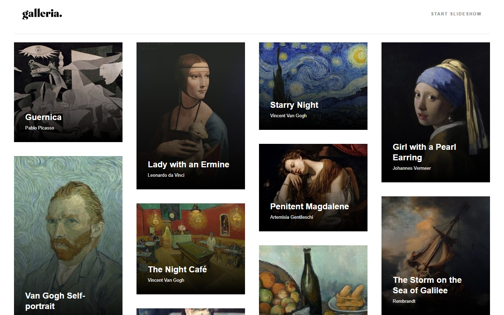

# Frontend Mentor - Galleria slideshow site solution

This is a solution to the [Galleria slideshow site challenge on Frontend Mentor](https://www.frontendmentor.io/challenges/galleria-slideshow-site-tEA4pwsa6). The site presents 15 artworks in a responsive gallery and a data-driven detail page.

## Table of contents

- [Overview](#overview)
  - [The challenge](#the-challenge)
  - [Screenshot](#screenshot)
  - [Links](#links)
- [My process](#my-process)
  - [Built with](#built-with)
  - [Implementation notes](#implementation-notes)
  - [What I learned](#what-i-learned)
  - [Run locally](#run-locally)

## Overview

### The challenge

Users can:

- Browse a responsive artwork gallery.
- Open a selected artwork and start the slideshow from that artwork.
- Navigate between artworks with the previous and next buttons.
- Pause or resume the slideshow and view the current painting in a dialog.

### Screenshot



### Links

- [Source code](https://github.com/jonghwascript/galleria-slideshow-site)
- [Live](https://jonghwascript.github.io/galleria-slideshow-site/index.html)
- [Frontend Mentor challenge](https://www.frontendmentor.io/challenges/galleria-slideshow-site-tEA4pwsa6)

## My process

### Built with

- Semantic HTML
- SCSS and Sass
- CSS Grid and Flexbox
- Vanilla JavaScript
- Gulp and BrowserSync

### Implementation notes

- `src/pages/data.json` supplies the artwork content, images, and title line breaks for the shared detail page.
- The gallery uses CSS Grid and JavaScript to balance columns while keeping keyboard navigation in visual order.
- The detail page uses a native `<dialog>` for the full artwork image and a `<progress>` element for slideshow progress.
- Slideshow state is reflected in the detail page URL so the selected artwork and playback state can be revisited.

### What I learned

I used AI to generate the initial HTML and CSS, then reviewed and refined the implementation with a focus on semantic HTML, accessibility, and responsive layout.
I also tested the result across different screen sizes and made adjustments to improve the code's flexibility and maintainability.
This challenge helped me practice reviewing AI-generated code and making more informed frontend development decisions.

I first explored native CSS masonry, but [browser support was still limited](https://developer.mozilla.org/en-US/docs/Web/CSS/Guides/Grid_layout/Grid_lanes) for this project. I used JavaScript with CSS Grid instead: the algorithm sorts cards by height, places each card in the shortest available column, and swaps cards between columns when that reduces the height difference. This keeps the columns as balanced as possible without assuming they will be exactly equal.

### Run locally

Install dependencies, generate the site in `dist`, and serve it over HTTP:

```bash
npm ci
npx gulp html scss static data
npx browser-sync start --server dist --port 3000
```

Open `http://localhost:3000/index.html` in a browser.
